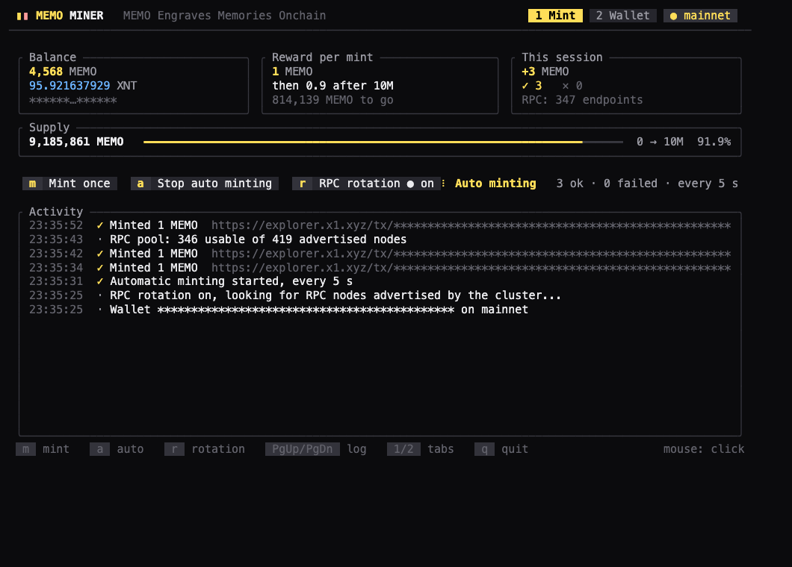
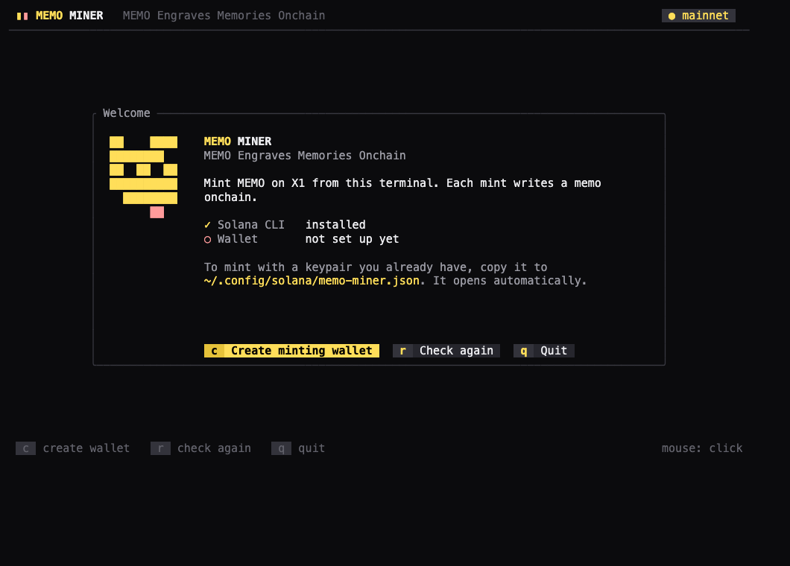
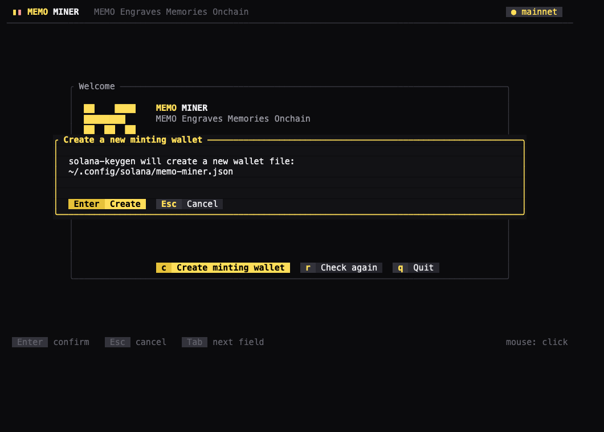
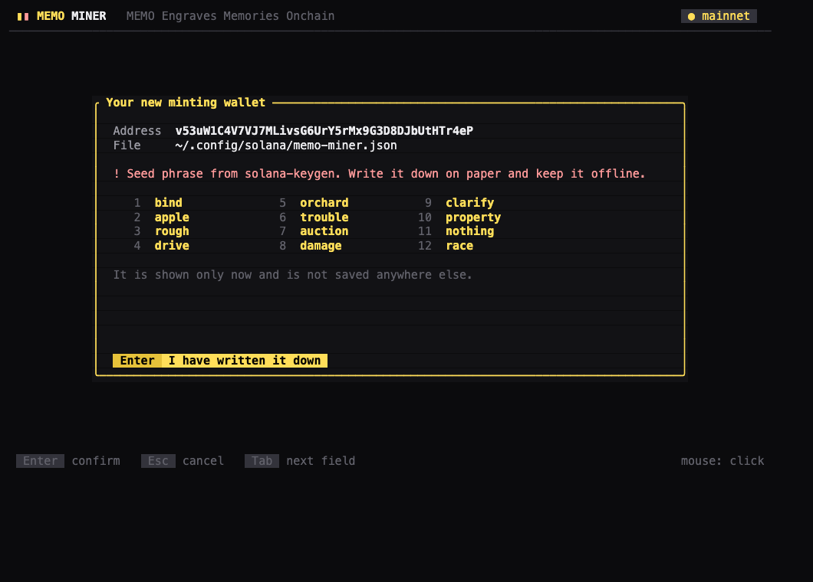
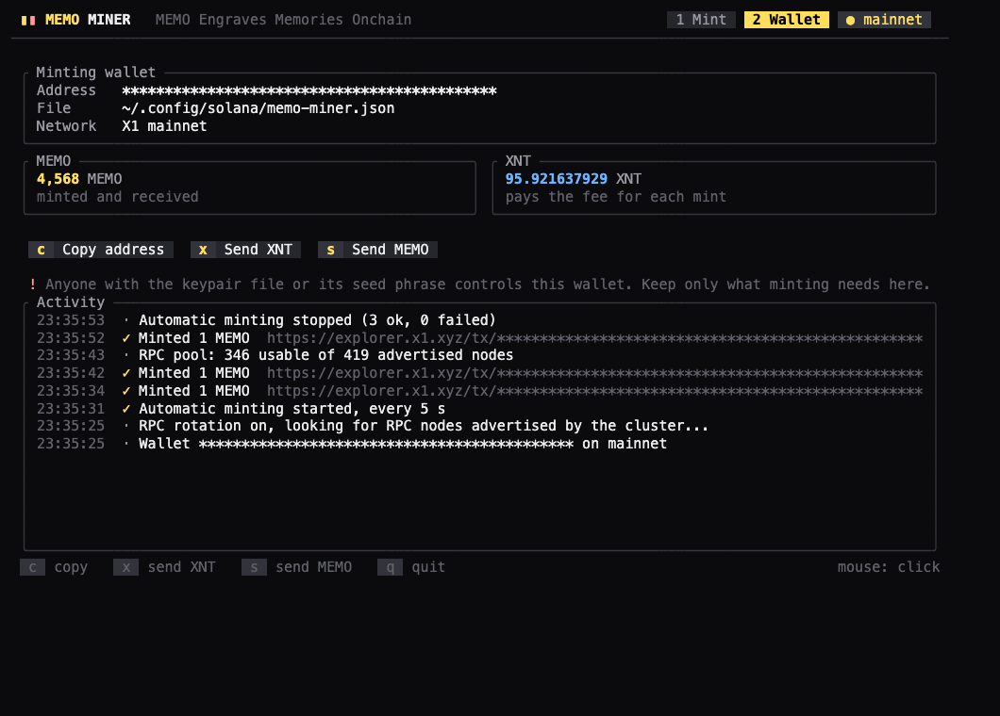
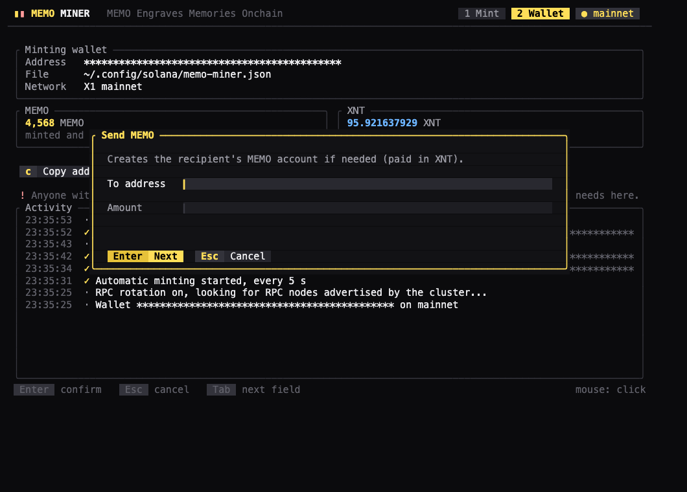

# MEMO Miner

**MEMO Engraves Memories Onchain.** MEMO Miner mints MEMO on the X1 chain from your terminal. Each mint is a transaction that writes a memo onchain and pays you the current MEMO reward.

- Manual minting: one mint per key press.
- Automatic minting: mints in a loop until you stop it.
- RPC rotation: spreads requests over the RPC nodes the X1 cluster advertises, so a single endpoint's rate limit does not stop you.
- Runs on Windows, macOS and Linux, in a terminal.
- Your wallet is created and kept by the official [Solana CLI](https://docs.anza.xyz/cli/install). MEMO Miner never generates keys itself.



## Install

Download the archive for your system from [Releases](https://github.com/xenartist/memo-miner/releases), unpack it and run `memo-miner` (`memo-miner.exe` on Windows) in a terminal.

Or build it with Rust:

```bash
cargo install --git https://github.com/xenartist/memo-miner
```

## Using it

Run `memo-miner`. Everything happens inside the terminal app, with the keyboard or the mouse. There is nothing to configure.

### First run

1. MEMO Miner looks for the Solana CLI (`solana-keygen`).
   If it is missing, **Install Solana CLI** runs Anza's official installer for the stable release and shows its output.
2. **Create minting wallet** runs `solana-keygen new` and shows the new address and seed phrase once.
   Write the seed phrase down and keep it offline.
3. Send a little XNT to the wallet address. XNT pays the fee for each mint.

| Welcome | Create minting wallet | Seed phrase |
| --- | --- | --- |
|  |  |  |

The seed phrase in the screenshot belongs to a throwaway wallet made for the screenshot. It has never held funds. Do not use it.

MEMO Miner always mints with one wallet: `~/.config/solana/memo-miner.json`, next to the Solana CLI's own keypairs (`%USERPROFILE%\.config\solana\memo-miner.json` on Windows). It opens automatically every time.

To mint with a keypair you already have, copy it to that path, before starting or while the welcome screen is open (it opens automatically):

```bash
cp ~/.config/solana/your-keypair.json ~/.config/solana/memo-miner.json
```

If `memo-miner.json` exists but cannot be read, **Create minting wallet** renames it with the date and time (`memo-miner-20261024-221500.json`) instead of overwriting it.

### Tabs

| Tab | What you can do | Keys |
| --- | --- | --- |
| 1 Mint | Mint once, start/stop automatic minting, turn RPC rotation on/off, read the activity log | `m`, `a`, `r`, PgUp/PgDn or the mouse wheel |
| 2 Wallet | Copy the address, send XNT, send MEMO | `c`, `x`, `s` |

Click any button or tab, or press its key. Switch tabs with `1`/`2` or Tab. Quit with `q`.

Transfers show a confirmation first.

| Wallet tab | Send MEMO |
| --- | --- |
|  |  |

The app captures the mouse. To select text in the terminal, hold Shift (Option in macOS Terminal and iTerm2) while dragging.

### Fixed behaviour

- **Network:** X1 mainnet.
- **RPC rotation:** on. Requests are spread over the public endpoint `rpc.mainnet.x1.xyz` and the RPC nodes listed by `getClusterNodes` that answer and are close to the tip. The node list is refreshed every 10 minutes. `r` turns rotation off for the current run.
  Most advertised nodes are plain HTTP. Signed transactions cannot be altered in transit, but balances shown while rotating come from whichever node answered.
- **Automatic minting:** a mint every 5 seconds after the previous one confirms. It stops on its own when the XNT balance falls below 0.01 XNT, or after 10 failed mints in a row.
- **Memo:** 69 bytes, the minimum memo-mint accepts, which keeps compute units and fees lowest:
  `{"action":"mint","platform":"memo-miner","chain":"X1","t":<unix seconds>}`

## How a mint is built

Each mint is one transaction with these instructions, in order:

1. An SPL Memo instruction at index 0 (69-800 bytes).
2. Only when the wallet has no MEMO account yet: an idempotent creation of its Token-2022 MEMO account.
3. memo-mint `process_mint`.
4. A compute unit limit: the units a simulation used plus 50. The fee follows this limit, so the margin is kept small.

The miner waits for each mint to confirm before sending the next.

## License

MIT
